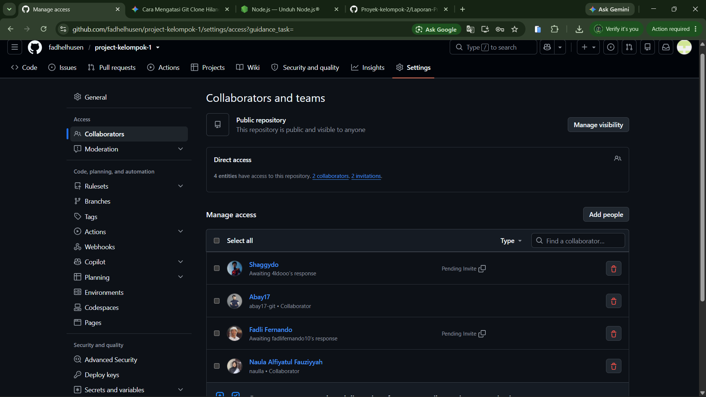
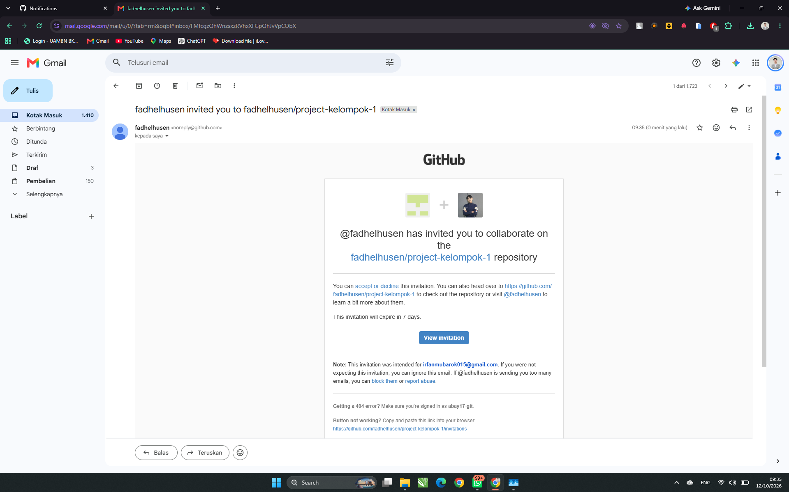

# Laporan Progres Kelompok 1 #
## Anggota Kelompok ##
1. Fadheel Abdillah Husen
2. Ahmad Ali Murtadlo
3. Fadli Fernando
4. Naula Alfiyatul Fauziyyah
5. Irfan Mubarok

### Progres 1 Pertemuan 5 ###
1. PM membuat repository dan invite member
2. Konfirmasi Bukti

3. PM membuat inisialisasi project
npx create-expo-app@latest

4. Konfirmasi Bukti

Tugas Member:
Fadli:
1. Accept Invitation
2. Bukti Konfirmasi
3. Clone Proyek
4. Bukti Konfirmasi

Aldo:
1. Accept invitation
2. Bukti Konfirmasi

3. Clone Proyek
4. Bukti Konfirmasi

Naula:
1. Accept invitation
2. Bukti konfirmasi
3. Clone proyek
4. Bukti konfirmasi

Irfan:
1. Accept invitation
2. Bukti konfirmasi
3. Clone proyek
4. Bukti konfirmasi

Tugas Bersama:
1. Diskusi Penentuan Tema

# Notulen diskusi Kelompok 1 #
Nama Kelompok   : Kelompok 1
Hari/Tanggal    : Kamis, 15 OKtober 2026
Tempat/Media    : Gedung Siber

## Agenda Diskusi ##
1.	Mengusulkan ide tema aplikasi mobile
2.	Menentukan target pengguna aplikasi

## Daftar Ide Tema ##

Fadheel:
* Tema :
* Target:

Fadli:
- Tema :
- Target:

Aldo:
- Tema :
- Target :

Naula :
- Tema :
- Target :

Irfan :
- Tema:
- Target:

## Hasil dan Keputusan ##
Tema yang diusulkan: 
Alasan pemilihan: 
Target pengguna:
